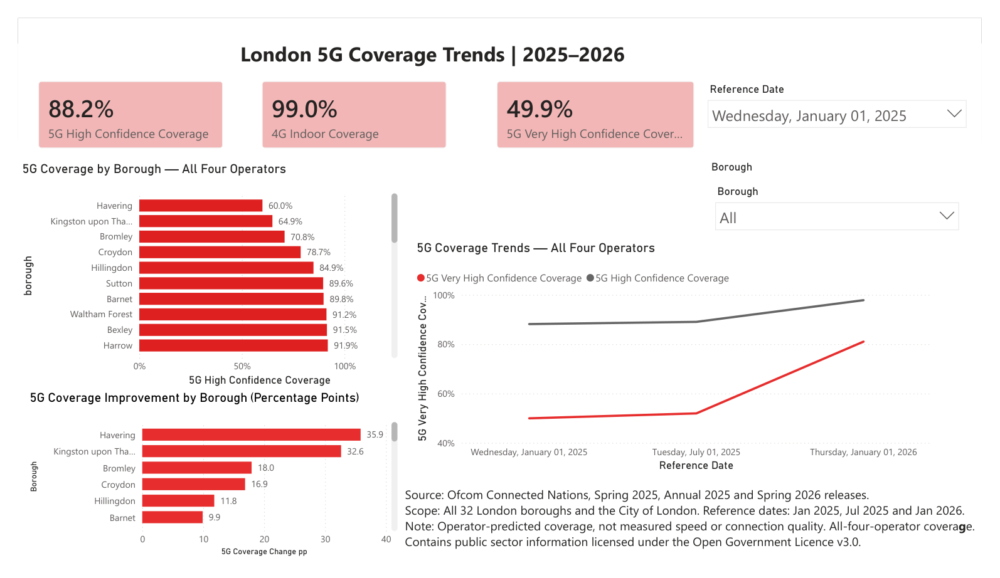

# London Mobile Coverage Analysis

Power BI prototype examining operator-predicted mobile coverage across all 32 London boroughs and the City of London.

[View the dashboard report (PDF)](reports/london_mobile_coverage_report.pdf)

## Scope

- 33 London local authorities.
- Three reference snapshots: January 2025, July 2025 and January 2026.
- Source: Ofcom Connected Nations, Spring 2025, Annual 2025 and Spring 2026.
- 4G indoor premises coverage; 5G geographic coverage at High Confidence and Very High Confidence thresholds.
- Headline coverage represents availability from all four operators, not an individual operator ranking.

The exported PDF has January 2025 selected: 88.2% 5G High Confidence geographic coverage, 49.9% 5G Very High Confidence geographic coverage and 99.0% 4G indoor premises coverage. The trend chart displays all three reference dates independently of the selected-date slicer.

## Analysis

The dashboard includes area-weighted 5G coverage, premises-weighted indoor 4G coverage, borough rankings, snapshot comparisons and January 2025–January 2026 coverage improvement in percentage points. Geographic coverage uses 100 m × 100 m source pixel counts for weights. These are approximate aggregates of rounded published percentages.

Power BI measures use DAX; data preparation and column typing use Power Query. The PDF is a static export; interactive filtering requires the Power BI Desktop report, which is not included in this version.

## Interpretation and limitations

This is predicted coverage supplied by operators, not measured user speed, latency, or connection reliability. The snapshots are not twelve monthly observations. High Confidence and Very High Confidence are Ofcom signal-threshold categories, not statistical confidence intervals. The open borough tables do not provide named individual-operator coverage values. Coverage improvement does not establish causality or determine a base-station deployment location.

## Project direction

Prepared as an initial prototype for a SoftITO Data Analytics graduation project. Future work aims to apply the approach to Istanbul using appropriately authorised, anonymised and aggregated network data, and develop a broader application incorporating geospatial analysis and software development. Future capabilities depend on data access and are not implemented in this dashboard.

## Sources and attribution

- [Ofcom Spring 2025](https://www.ofcom.org.uk/phones-and-broadband/coverage-and-speeds/connected-nations-update-spring-2025)
- [Ofcom Connected Nations 2025 data](https://www.ofcom.org.uk/phones-and-broadband/coverage-and-speeds/connected-nations-20252/data-downloads-2025?language=en)
- [Ofcom Spring 2026](https://www.ofcom.org.uk/phones-and-broadband/coverage-and-speeds/connected-nations-update-spring-2026)

Contains public sector information licensed under the [Open Government Licence v3.0](https://www.nationalarchives.gov.uk/doc/open-government-licence/version/3/).